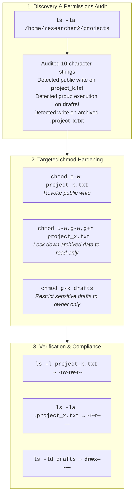

# 🛡️ Linux File Permissions & Least Privilege Audit Lab


---

## 📌 Project Overview & Academic Provenance

This hands-on cybersecurity audit lab is derived directly from the **Google Cybersecurity Professional Certificate** (*Course 4: Linux and SQL*).

The project simulates an operational security assessment on a Linux enterprise server (`/home/researcher2/projects`) where research documents, confidential archives, and draft proposals were audited against the **Principle of Least Privilege (PoLP)** and organizational authorization policies.

---

## 🎯 Key Scenarios & Remediations Audited

| Target Item | Pre-Audit Permissions | Vulnerability Identified | Remediation Command | Post-Audit Permissions | Resulting Security Posture |
| :--- | :---: | :--- | :--- | :---: | :--- |
| **`project_k.txt`** | `-rw-rw-rw-` | Unauthorized write access to **Others** (world-writable) | `chmod o-w project_k.txt` | `-rw-rw-r--` | World write revoked; unauthorized tamper prevention. |
| **`.project_x.txt`** (Hidden) | `-rw--w----` | Archived file writable by user & group; group lacks read | `chmod u-w,g-w,g+r .project_x.txt` | `-r--r-----` | Locked down to read-only for user & group; tamper-proof archive. |
| **`drafts/`** (Directory) | `drwx--x---` | Group members had execution (`x`) access to enter directory | `chmod g-x drafts` | `drwx------` | Restricted exclusively to `researcher2`; others receive permission denied. |

---

## 🏗️ Audit & Verification Workflow



---

## 🧪 Reproducible Hands-on Simulation

A Bash script ([`scripts/reproduce_permissions_lab.sh`](scripts/reproduce_permissions_lab.sh)) is included to recreate the directory tree, inject the vulnerable permission baseline, and apply the hardening fixes:

```bash
# Clone the repository
git clone https://github.com/edusouzamarques/linux-file-permissions-least-privilege-audit.git
cd linux-file-permissions-least-privilege-audit

# Run the automated reproduction script
./scripts/reproduce_permissions_lab.sh
```

---

## 📂 Repository Layout

```
├── README.md                                             # Portfolio documentation & summary
├── reports/
│   └── LINUX_FILE_PERMISSIONS_AUDIT_REPORT.md           # Formal audit report with terminal telemetry
├── scripts/
│   └── reproduce_permissions_lab.sh                     # Deterministic lab reproduction script
└── docs/                                                 # Linux permissions & chmod cheat sheet
```

---

## 👤 Author & Cybersecurity Portfolio

**Eduardo Souza Marques**  
- **GitHub:** [@edusouzamarques](https://github.com/edusouzamarques)  
- **Portfolio Showcase:** [edusouzamarques.github.io/cybersec](https://edusouzamarques.github.io/cybersec/)  
- **Certifications & Training:** Google Cybersecurity Professional Certificate, CompTIA Security+ SY0-701 Preparation
