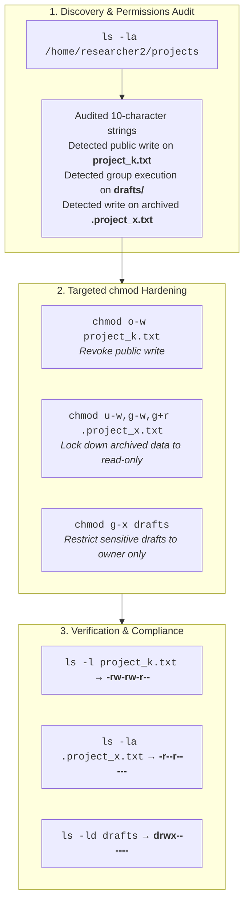

# 🛡️ Linux File Permissions & Least Privilege Audit Report

**Academic & Professional Provenance:** Google Cybersecurity Professional Certificate (Course 4: *Linux and SQL*)  
**Target Environment:** `/home/researcher2/projects` (Linux OS File System)  
**Lead Cybersecurity Analyst:** Eduardo Souza Marques ([@edusouzamarques](https://github.com/edusouzamarques))  
**Core Principles:** Principle of Least Privilege (PoLP) / Access Governance / File System Hardening  
**Status:** Audit Completed, Vulnerabilities Remediated & Documented  

---

## 1. Project Description

As a security professional for a large organization, I was tasked with auditing and remediating file and directory permissions for the research team. Inappropriate permissions on system files expose sensitive data to unauthorized alteration, data leakage, or privilege escalation. 

Using Linux command-line tools, I inspected existing permissions across the `projects` directory, analyzed 10-character permission strings, and reconfigured access controls using `chmod` to enforce the **Principle of Least Privilege (PoLP)**.

---

## 2. Terminal Telemetry & Audit Evidence



---

## 3. Section-by-Section Audit Breakdown

### Section 1: Check File and Directory Details
```bash
ls -la /home/researcher2/projects
```
- **Explanation:** The `ls` command lists directory contents. The `-l` flag displays output in the long-listing format, detailing the 10-character permission string, owner user, owner group, size, and modification timestamp. The `-a` flag reveals all files, including hidden files that begin with a dot (`.`).
- **Terminal Evidence:**
```text
researcher2@286518faed6c:~$ ls -la /home/researcher2/projects
total 32
drwxr-xr-x 3 researcher2 research_team 4096 Nov  8 23:53 .
drwxr-xr-x 3 researcher2 research_team 4096 Nov  9 00:52 ..
-rw--w---- 1 researcher2 research_team   46 Nov  8 23:53 .project_x.txt
drwx--x--- 2 researcher2 research_team 4096 Nov  8 23:53 drafts
-rw-rw-rw- 1 researcher2 research_team   46 Nov  8 23:53 project_k.txt
-rw-r----- 1 researcher2 research_team   46 Nov  8 23:53 project_m.txt
-rw-rw-r-- 1 researcher2 research_team   46 Nov  8 23:53 project_r.txt
-rw-rw-r-- 1 researcher2 research_team   46 Nov  8 23:53 project_t.txt
```

---

### Section 2: Describe the Permissions String
- **Selected File:** `project_k.txt` (`-rw-rw-rw-`)
- **Structure Breakdown:**
  1. **Character 1 (`-`):** Regular file.
  2. **Characters 2–4 (`rw-`):** **User (Owner)** permissions. The user `researcher2` has read (`r`) and write (`w`) permissions.
  3. **Characters 5–7 (`rw-`):** **Group** permissions. Members of `research_team` have read (`r`) and write (`w`) permissions.
  4. **Characters 8–10 (`rw-`):** **Other (World)** permissions. All other users on the operating system have read (`r`) and write (`w`) permissions.
- **Security Impact:** Allowing public write access violates core access policies because unauthorized external accounts can modify, tamper with, or delete research project data.

---

### Section 3: Change File Permissions (`project_k.txt`)
- **Vulnerability:** Unrestricted write access for Others.
- **Remediation Command:**
```bash
cd projects
chmod o-w project_k.txt
```
- **Verification:**
```bash
ls -l project_k.txt
```
- **Terminal Evidence:**
```text
researcher2@286518faed6c:~/projects$ chmod o-w project_k.txt
researcher2@286518faed6c:~/projects$ ls -l
total 20
drwx--x--- 2 researcher2 research_team 4096 Nov  8 23:53 drafts
-rw-rw-r-- 1 researcher2 research_team   46 Nov  8 23:53 project_k.txt
-rw-r----- 1 researcher2 research_team   46 Nov  8 23:53 project_m.txt
-rw-rw-r-- 1 researcher2 research_team   46 Nov  8 23:53 project_r.txt
-rw-rw-r-- 1 researcher2 research_team   46 Nov  8 23:53 project_t.txt
```
*Result:* Others permissions updated to read-only (`r--`).

---

### Section 4: Change File Permissions on a Hidden File (`.project_x.txt`)
- **Vulnerability:** Archived file had unauthorized write permissions for user and group (`-rw--w----`), and lacked group read access.
- **Remediation Command:**
```bash
chmod u-w,g-w,g+r .project_x.txt
```
- **Verification:**
```bash
ls -la .project_x.txt
```
- **Terminal Evidence:**
```text
researcher2@286518faed6c:~/projects$ chmod u-w,g-w,g+r .project_x.txt
researcher2@286518faed6c:~/projects$ ls -la
total 32
drwxr-xr-x 3 researcher2 research_team 4096 Nov  8 23:53 .
drwxr-xr-x 3 researcher2 research_team 4096 Nov  9 00:52 ..
-r--r----- 1 researcher2 research_team   46 Nov  8 23:53 .project_x.txt
drwx--x--- 2 researcher2 research_team 4096 Nov  8 23:53 drafts
-rw-rw-r-- 1 researcher2 research_team   46 Nov  8 23:53 project_k.txt
-rw-r----- 1 researcher2 research_team   46 Nov  8 23:53 project_m.txt
-rw-rw-r-- 1 researcher2 research_team   46 Nov  8 23:53 project_r.txt
-rw-rw-r-- 1 researcher2 research_team   46 Nov  8 23:53 project_t.txt
```
*Result:* Archived project is now strictly read-only (`-r--r-----`).

---

### Section 5: Change Directory Permissions (`drafts`)
- **Vulnerability:** Group possessed execution permission (`drwx--x---`), allowing unauthorized users to enter (`cd`) and access preliminary research proposals.
- **Remediation Command:**
```bash
chmod g-x drafts
```
- **Verification:**
```bash
ls -ld drafts
```
- **Terminal Evidence:**
```text
researcher2@286518faed6c:~/projects$ chmod g-x drafts
researcher2@286518faed6c:~/projects$ ls -l
total 20
drwx------ 2 researcher2 research_team 4096 Nov  8 23:53 drafts
-rw-rw-r-- 1 researcher2 research_team   46 Nov  8 23:53 project_k.txt
-rw-r----- 1 researcher2 research_team   46 Nov  8 23:53 project_m.txt
-rw-rw-r-- 1 researcher2 research_team   46 Nov  8 23:53 project_r.txt
-rw-rw-r-- 1 researcher2 research_team   46 Nov  8 23:53 project_t.txt
```
*Result:* Directory isolated exclusively to `researcher2` (`drwx------`).

---

## 4. Summary & Organizational Impact

Through this security audit, I successfully inspected, analyzed, and modified file system permissions to align with organizational security policies and the **Principle of Least Privilege**.

Using `ls -la`, I identified improper permissions on both standard and hidden files. Using the `chmod` command, I revoked unauthorized public write access on `project_k.txt`, secured the archived `.project_x.txt` file as read-only, and fully restricted access to the sensitive `drafts` directory to its owner.

These actions minimize the system’s attack surface, enforce non-repudiation, and ensure sensitive research assets are protected from unauthorized modification or disclosure.
